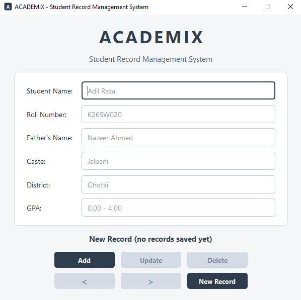

# ACADEMIX - Student Record Management System

ACADEMIX is a desktop application for managing student records, built with C++17 and Qt 6 Widgets. It was developed as a semester project for the Programming Fundamentals course.

## Screenshot



## Features

- Add, Update, Delete, Previous, Next and New Record operations
- Six fields per student: Student Name, Roll Number, Father's Name, Caste, District and GPA
- All fields are required
- GPA validation (0.00 to 4.00, numbers only)
- Unique Roll Number for every record
- Confirmation before a record is deleted
- "Record x of y" position indicator
- Permanent storage in a CSV file (`students.csv`)
- Safe handling of commas and quotation marks in text fields

## Technologies Used

- C++17
- Qt 6 Widgets (graphical user interface)
- CMake (build system)
- CSV text file (storage)

## Project Structure

| File | Purpose |
|------|---------|
| `main.cpp` | Starts the application and shows the main window |
| `student.h` / `student.cpp` | `Student` class: one record with six fields, constructors, getters and setters |
| `studentmanager.h` / `studentmanager.cpp` | `StudentManager` class: stores records, navigation, Roll Number uniqueness, add/update/delete and CSV reading/writing |
| `mainwindow.h` / `mainwindow.cpp` | `MainWindow` class: builds the interface, validates input, connects buttons and shows messages |
| `students.csv` | Data file (created automatically if missing) |
| `CMakeLists.txt` | CMake build configuration |

## Requirements

- Windows 10 or later (Developed and tested on Windows 10)
- Qt 6 (MinGW build)
- MinGW GCC 13.1.0
- CMake 3.21 or newer
- Ninja

## How to Build

Open a terminal inside the project folder and run the commands below. Change the Qt and MinGW paths to match your own installation.

```
cmake -S . -B build -G Ninja -DCMAKE_BUILD_TYPE=Debug -DCMAKE_PREFIX_PATH=C:/Qt/6.12.0/mingw_64 -DCMAKE_CXX_COMPILER=C:/Qt/Tools/mingw1310_64/bin/g++.exe
cmake --build build
```

## How to Run

Add the Qt and MinGW folders to PATH for the current terminal, then start the program:

```
set PATH=C:\Qt\6.12.0\mingw_64\bin;C:\Qt\Tools\mingw1310_64\bin;%PATH%
build\Academix.exe
```

Alternatively, run `windeployqt build\Academix.exe` once to copy the required Qt files next to the program.

## How to Use

1. **Add a record:** fill in all six fields and click **Add**.
2. **Browse records:** use **Previous** and **Next**. The label shows the position, for example "Record 3 of 10".
3. **Update a record:** show the record, change the fields and click **Update**. The Roll Number can be changed only to one that is not already used.
4. **Delete a record:** show the record and click **Delete**, then confirm.
5. **New Record:** empties the form and returns to new-record mode.

## Data Storage

Records are saved in `students.csv` in the project folder. The first line is a header:

```
Name,RollNumber,FatherName,Caste,District,GPA
```

Text containing commas or quotation marks is wrapped in quotes so the file is never corrupted.

## Limitations

- Records are shown one at a time. There is no table view, search or sorting.
- The whole CSV file is rewritten on every add, update or delete, which is fine for a small number of records but slow for a very large number.
- Data is stored as plain text with no encryption or login.
- The program is designed for one user at a time and does not handle several copies using the same file.
- `students.csv` is saved in the project folder the program was built from, so a copy of the program moved to another computer will not find the data.

## Author

**Adil Raza**

BE Software Engineering, 1st Semester

Course: Programming Fundamentals

Mehran University of Engineering and Technology

*This project was developed as Semester Project.*
